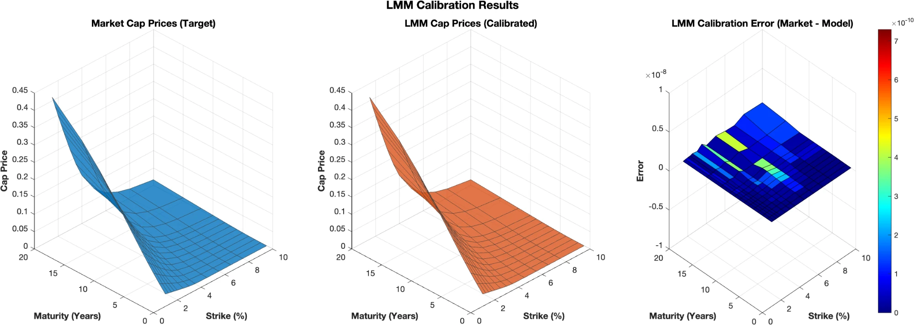
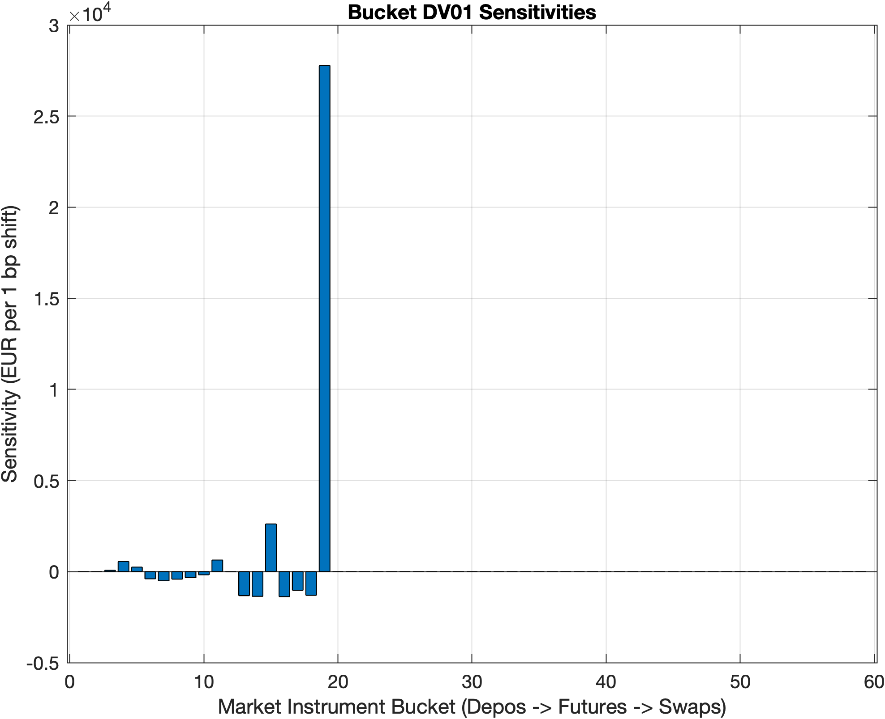

# Financial Engineering — Assignment 5

LMM/BMM interest-rate model calibration, structured-bond Delta and Vega
bucket risk with coarse-grained hedging, digital smile-risk correction,
and Monte Carlo pricing of a path-dependent exotic cap under the Bond
Market Model. Pure MATLAB.

Financial Engineering, MSc in Mathematical Engineering — Politecnico di
Milano, AY 2025/26. Individual solution.

---

## The exercises

| # | Topic |
|---|---|
| 1a | LMM spot volatility calibration from flat cap vols |
| 1b/g | Fair upfront of a structured bond, with digital smile-risk correction |
| 1c | Delta-bucket sensitivities (DV01) across all calibration pillars |
| 1d | Total Vega — Model vs. Market measures |
| 1e | Delta hedge with coarse-grained swap buckets |
| 1f | Vega hedge with coarse-grained cap buckets |
| 2a | BMM spot volatility calibration |
| 2b | Monte Carlo pricing of a path-dependent exotic cap under BMM |

Full write-up of methodology, results and discussion in
[`Report.pdf`](Report.pdf).

## Selected results

| Exercise | Result |
|---|---|
| 1b/g — Fair upfront | $12.9841\%$ uncorrected vs. $12.7677\%$ smile-corrected — a $-$€108,210 digital-risk adjustment |
| 1c — DV01 buckets | Bucket sum €23,670.86 vs. parallel-shift €23,679.01 (0.03% reconciliation gap); risk concentrated in the 10y pillar (€27,780.76/bp) |
| 1d — Vega | Model Vega €150,587.30 vs. Market Vega €144,281.78 per 1% shift — a €6,306 recalibration effect |
| 1e — Delta hedge | Exact and backward-substitution solves agree to the cent; 10y receiver-swap notional (€32.49M) dominates |
| 1f — Vega hedge | 6y/10y cap notionals of $-$€16.0M / $-$€47.5M; exact = triangular solve |
| 2b — Exotic cap (BMM, MC) | $0.6254\%\pm0.0022\%$ (95% CI $[0.6211\%,0.6297\%]$), $N=10{,}000$ paths |

Two things worth flagging, because they are easy to miss:

**Calibration is validated by a price-error surface, not by eyeballing the
vol-surface shape.** Rather than plotting the calibrated spot-vol surface
and describing its qualitative features, calibration quality here is
checked by comparing market cap prices against model cap prices and their
difference, directly on the pricing grid (Figure 1). This is a strictly
quantitative pass/fail check: the LMM bootstrap recovers market prices to
$\sim7\times10^{-10}$ and the BMM bootstrap to $\sim7\times10^{-12}$ —
both far inside the $\pm10^{-8}$ tolerance enforced on the plot — rather
than "the shape looks right."

**Two independent Vega measures isolate the recalibration effect.**
Bumping the already-calibrated LMM spot vols directly (Model Vega,
€150,587.30) and bumping the quoted flat vols and fully recalibrating
before repricing (Market Vega, €144,281.78) are not the same operation —
the €6,306 gap between them is exactly the effect of the LMM bootstrap
not translating a flat-vol parallel shift into an identical parallel
shift of every spot vol. Computing only one of the two would hide this.



*Exercise 1a — LMM calibration validated as a price-error surface across
the full expiry/strike grid, rather than a spot-vol surface plot.*



*Exercise 1c — Bucket DV01 sensitivities. Risk is overwhelmingly
concentrated in the 10-year swap pillar, driven by discounting the €50M
principal repayment at maturity.*

## Method notes (non-obvious choices)

- **Ex. 1a/2a (calibration check)** — see the first flag above: validated
  via a price-error surface rather than a qualitative vol-surface plot.
- **Ex. 1c (DV01)** — computed under a sticky-vol convention (curve
  shocked, LMM spot vols held fixed), cross-checked against an
  independently-computed parallel-shift DV01 (all instruments bumped
  simultaneously in one bootstrap/reprice pass, not just the trivial sum
  of the buckets) — a 0.03% reconciliation gap confirms no overlap or gap
  in the bucket construction.
- **Ex. 1d (Vega)** — see the second flag above: two independent
  measures, Model Vega and Market Vega.
- **Ex. 1e/1f (hedging)** — both hedge systems are solved two ways (an
  exact linear solve and a backward-substitution triangular solve
  exploiting the near-triangular bucket-sensitivity matrix) and compared
  directly; the two agree to the cent in both cases.
- **Ex. 1e (sign convention)** — the hedging swaps are priced on a
  receiver basis (receive fixed, pay floating); a positive notional in
  the output denotes a receiver-swap position, not a payer-swap position.
- **Ex. 2b (exotic cap)** — priced by a single spot/rolling-measure Monte
  Carlo. The payoff's strike depends on the previous Libor fixing, so it
  cannot be priced off a closed-form caplet formula with a deterministic
  strike and requires full path simulation.

## Repository layout

```
runAssignment05.m    Entry point -- runs Exercises 1 and 2 end-to-end
Bootstrap/            Zero-coupon curve bootstrapping utilities
CalibrationLLM/       Exercise 1a: LMM spot vol calibration
Ex1b&g/               Exercise 1b/g: upfront, digital smile correction
Ex1c/                 Exercise 1c: Delta-bucket DV01 + parallel reconciliation
Ex1d/                 Exercise 1d: Model and Market Vega
Ex1e/                 Exercise 1e: coarse-grained Delta hedge (swaps)
Ex1f/                 Exercise 1f: coarse-grained Vega hedge (caps)
Ex2/                  Exercise 2: BMM calibration and exotic cap Monte Carlo
  CalibrationBMM/       BMM spot vol calibration
  MCPricing/            Monte Carlo simulation and pricing engine
Plots/                Calibration validation plotting utility
Utils/                Shared helpers (payment schedule, swap pricer)
figures/              Figures referenced by this README and by the report
Report.pdf            Full written report (methodology, results, discussion)
```

## Running it

```matlab
runAssignment05
```

The script adds all subfolders to the MATLAB path automatically
(`addpath(genpath(...))`), bootstraps the discount curve, then runs
Exercise 1 (LMM calibration, upfront pricing, Delta/Vega bucket risk and
hedging) followed by Exercise 2 (BMM calibration and exotic cap Monte
Carlo pricing) end to end, printing a formatted report for each step to
the console and producing the relevant plots.

## Requirements

- MATLAB
- **Statistics and Machine Learning Toolbox** — `normcdf`/`norminv` (Black-76 formulas)
- No Optimization Toolbox required — calibration uses `fzero` (base MATLAB), not `fsolve`

## Author

Filippo Cuoghi
